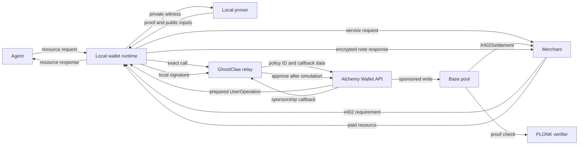

# Architecture

## Scope

GhostClaw provides confidential payment amounts for public agent identities.
The payer and merchant use visible Base addresses. Private note values stay in
the local wallet.

The public deployment uses Base Sepolia chain ID `84532`. The pool constructor
enforces this chain ID.

## Components

### npm package

The public client is one `ghostclaw` package. It provides a human CLI, a local
stdio MCP server, and a fetch-compatible library export.

`ghostclaw start` provides the guided testnet path. One human approval permits
wallet creation, registration, agent connection, and a private test deposit.
Progress messages use standard error. The final machine-readable result uses
standard output.

An interactive start opens Claude Code or Codex with a guided demo prompt. The
prompt includes the public Base account and wallet-ready state. The agent reads
the public spending policy through MCP. It asks for explicit approval before
the 1 gUSD demo payment. The prompt does not include a private balance or note.

npm selects one platform-specific native prover package. First use downloads
12.5 MiB of pinned proving files into `~/.ghostclaw/artifacts/v2/1.5.0/`.

The public Vercel deployment serves the versioned files. The package pins each
file name, size, and SHA-256 hash. CI checks the deployed file set before a
package release.

See `docs/PACKAGE_DISTRIBUTION.md` for the complete package boundary.

### Agent

The agent requests a service. The merchant returns an x402 payment requirement.
The agent applies its local payment policy before it starts a payment. The MCP
surface contains only `ghostclaw_fetch` and `ghostclaw_check_budget`.

### Local wallet

The Node runtime keeps three key domains:

- A Base transaction key signs public calls.
- A spend key controls private notes.
- An X25519 note key decrypts received notes.

The runtime encrypts each key domain with AES-256-GCM. The operating-system
credential store protects the encryption keys. A passphrase file supports SSH
hosts and containers. A hardware signer can replace the local Base transaction
key.

The wallet stores note amounts, blindings, tree positions, and transaction
history in encrypted local state.

### Local proof runtime

The Go runtime uses Consensys gnark PLONK on BN254. It creates identity,
deposit, payment, and withdrawal proofs. Each proof is 768 bytes.

Private witnesses enter through standard input. The proof process has an
8 GiB operating-system memory limit. Go also receives a 6 GiB soft memory
limit. Each proof command has a 120-second timeout.

### Transaction adapter

The adapter converts one wallet action into an exact contract call. It checks
the contract target and function before it contacts the relay.

Alchemy returns a sponsored EIP-4337 UserOperation. It can also return an
EIP-7702 authorization. The adapter checks every returned field before local
signing. It checks the fixed Alchemy delegation runtime before each write.

### Hosted relay

The public relay stores the Alchemy API key and policy ID. A client does not
receive either value.

The relay accepts these Wallet API methods:

- `wallet_prepareCalls`
- `wallet_sendPreparedCalls`
- `wallet_getCallsStatus`

The relay permits only listed GhostClaw functions. It validates prepared calls,
signed calls, local signatures, chain ID, contract target, call data, native
value, paymaster data, and delegation target.

Shared Redis counters apply one atomic decision across all relay instances.
The keys use HMAC values for IP and sender identity. Raw IP addresses do not
enter Redis keys.

The relay also serves one public note snapshot. The response contains only the
commitment events that Base already exposes. It contains no account request,
private note, balance, or payment amount.

The wallet adds events that appeared after the snapshot. It rebuilds the tree
locally. It checks the leaf count and root against the pool at one fixed Base
block. An incorrect snapshot starts the direct Base fallback.

The hosted function reads Base in bounded ranges with two concurrent requests.
It retries a provider limit with a bounded delay.
Vercel caches one shared response for five minutes. Each wallet reads newer
events directly before it checks the current tree.

The function records only a fixed failure stage when a public tree read fails.
It does not record an RPC URL, a wallet address, a note, or an amount.

### Alchemy sponsorship callback

Alchemy sends each sponsorship request to `/alchemy/sponsor`. The relay injects
a secret callback value through `webhookData`. The callback compares that value
in constant time.

The callback decodes the UserOperation. It repeats the exact call policy. It
then simulates the call through an independent Base RPC. Any error stops
sponsorship.

### Pool

The pool holds test gUSD in escrow. It stores public identities, note
commitments, recent tree roots, nullifiers, payment intents, and recovery state.

The pool calls a separate Solidity verifier for each proof type. It inserts two
leaf positions after each deposit, payment, or withdrawal.

### Merchant service

The merchant sends the x402 payment requirement through TLS. It receives the
payment response through the same protected channel.

The merchant runtime gets the Base transaction and receipt from an independent
RPC. It checks the pool call, settlement event, request binding, payment intent,
note commitment, root, and replay state before it imports the note.

Express, Hono, and Next.js adapters create the payment requirement. A hosted
facilitator performs the public Base checks. The merchant runtime performs the
private note and request-binding checks before it releases the resource.

### Address-report demo

The hosted test service protects `/demo/address-report` with the same merchant
gate. The payer runtime and proof stay on the user machine.

The demo merchant uses a dedicated Base Sepolia identity. Its state is sealed
with AES-256-GCM before storage. Vercel holds the encryption secret. Redis holds
the ciphertext, an atomic wallet lock, and durable report jobs.

The public merchant manifest stays in Git. The full encrypted seed is supplied
through `GHOSTCLAW_DEMO_MERCHANT_DEPLOYMENT_JSON`. The handler authenticates it
and compares its identity with the public manifest before using Redis. See
[merchant configuration](MERCHANT_CONFIGURATION.md) before deploying this change.

The hosted merchant uses the packaged native note inspector. Note inspection
checks the decrypted note against the settled commitments and payment intent.
It does not load proving keys or create a proof on the server.

The release test starts the native inspector under Vercel conditions. It
removes `LAMBDA_TASK_ROOT` to test the loaded-bundle fallback. A separate Base
Sepolia acceptance test buys and retrieves one hosted report.

The paid request creates one deterministic job identifier. A retry returns the
same report. The report expires after seven days. It contains public Base data
and an explicit privacy boundary.

## Payment data flow



## Identity model

The circuit derives one private owner field from these values:

```text
owner = Poseidon(domain, protocolVersion, chainId, poolContext, spendKey)
```

The owner field is public. The spend key stays private. One owner maps to one
Base account.

Registration needs an identity proof. Rotation needs the current spend key and
a signature from the new Base account. Recovery uses the same proof binding and
adds a seven-day delay.

## Note tree

The pool keeps a depth-20 append-only Poseidon2 tree. It can hold 1,048,576 leaf
positions. Each state transition appends an ordered pair.

The pool keeps the latest 256 roots. A proof can use any retained root. New
transactions do not require a keeper or offchain batcher.

A deposit appends the new commitment and one zero leaf. A payment appends two
nonzero output commitments. A withdrawal appends its change commitment and one
zero leaf. A full withdrawal appends two zero leaves.

The payment circuit randomizes the merchant output position. Public observers
see two commitments. They cannot identify the merchant output from its position
alone.

## Deposit transition

The deposit proof binds the public amount and registered owner to the private
spend key and blinding. The pool transfers the exact public token amount into
escrow. It then appends the commitment.

## Payment transition

The payment proof checks membership for one private input note. It proves value
conservation between the merchant note and payer change note.

The proof binds these public identities:

- The Base payer.
- The Base merchant.
- The payer owner field.
- The merchant owner field.

It also binds the salted x402 request digest to the private amount. The pool
marks the nullifier and payment intent as used before it emits settlement.

## Withdrawal transition

The withdrawal proof checks membership and note ownership. It binds the public
amount, payer, recipient, and owner. The pool marks the input nullifier. It then
transfers the public amount to the recipient.

## Asset accounting

`totalEscrowed` increases after a deposit. It decreases before a withdrawal.
The pool checks token balances before and after each transfer.

The token must have exact transfers. A fee token or rebasing token causes the
transaction to fail.

## Trust boundaries

The Base contract enforces note ownership, value conservation, nullifier use,
identity binding, and escrow accounting.

Alchemy can delay or refuse a sponsored transaction. It cannot create a valid
GhostClaw proof. A user needs Base gas or another relay if sponsorship stops.

The local host can expose wallet secrets if it is compromised. The operating
system and credential store remain part of the wallet security boundary.

The universal SRS comes from Aztec Ignition. GhostClaw did not run a separate
ceremony.

## Implementation index

| Concern | Source |
|---|---|
| Circuit statements | `internal/circuit/v2.go` |
| Poseidon2 and tree model | `internal/model/poseidon.go`, `internal/model/tree.go` |
| Dynamic witness checks | `internal/operation/v2.go` |
| Proof setup and output | `internal/proving/system.go` |
| Prover command | `cmd/ghostclaw-prover/main.go` |
| Process memory limit | `cmd/ghostclaw-prover-limiter/` |
| Wallet command | `scripts/ghostclaw.mjs` |
| Guided setup | `scripts/lib/onboarding.mjs` |
| Agent fetch library | `src/index.mjs`, `scripts/lib/x402-client.mjs` |
| Agent budget | `scripts/lib/agent-policy.mjs` |
| MCP server | `scripts/mcp-server.mjs` |
| Package artifacts | `scripts/lib/artifact-installer.mjs` |
| Native package resolver | `scripts/lib/native-prover.mjs` |
| Merchant middleware | `packages/merchant-core/index.mjs`, `packages/express/`, `packages/hono/`, `packages/next/` |
| Hosted facilitator | `scripts/lib/facilitator-server.mjs` |
| Hosted address report | `scripts/lib/demo-address-report.mjs`, `api/demo-address-report.mjs` |
| Hosted merchant state | `scripts/lib/demo-merchant-store.mjs`, `scripts/lib/sealed-json.mjs` |
| Hosted Redis data | `scripts/lib/upstash-store.mjs` |
| Encrypted state | `scripts/lib/state.mjs` |
| File ownership checks | `scripts/lib/file-security.mjs`, `scripts/file-security.test.mjs` |
| Hosted runtime test | `scripts/hosted-runtime.test.mjs` |
| Hosted paid acceptance | `scripts/verify-hosted-payment.mjs` |
| Transaction adapter | `scripts/lib/alchemy-adapter.mjs` |
| Public note snapshot | `scripts/lib/note-tree-service.mjs`, `scripts/lib/tree-sync.mjs` |
| Relay policy | `scripts/lib/relay-policy.mjs` |
| Sponsorship policy | `scripts/lib/sponsorship-policy.mjs` |
| Shared rate limits | `scripts/lib/relay-rate-limiter.mjs` |
| Independent simulation | `scripts/lib/sponsor-simulation.mjs` |
| Pool | `contracts/GhostClawGnarkPlonkPoolV2.sol` |
| Test token | `contracts/GhostClawTestUSDV2.sol` |
