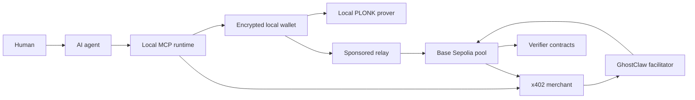

# GhostClaw documentation

**Release:** 1.5.7\
**Network:** Base Sepolia\
**Asset:** valueless test gUSD\
**Status:** public testnet preview\
**Updated:** 12 August 2026

GhostClaw gives AI agents a confidential payment method for x402 services.

The payer and merchant keep public identities. The payment amount and private balance stay off the public blockchain.

GhostClaw generates each payment proof on the payer's machine. Base verifies the proof before it changes the private payment pool.

This release uses test money. Do not deposit an asset with market value.

## Contents

- [Start in five minutes](#start-in-five-minutes)
- [What GhostClaw does](#what-ghostclaw-does)
- [What privacy means](#what-privacy-means)
- [How a payment works](#how-a-payment-works)
- [System architecture](#system-architecture)
- [Local wallet](#local-wallet)
- [Agent controls](#agent-controls)
- [Client library](#client-library)
- [x402 integration](#x402-integration)
- [Proof system](#proof-system)
- [Base contracts](#base-contracts)
- [Demonstration deployment](#demonstration-deployment)
- [Sponsored transactions](#sponsored-transactions)
- [Merchant integration](#merchant-integration)
- [Performance](#performance)
- [Security model](#security-model)
- [Command reference](#command-reference)
- [Troubleshooting](#troubleshooting)
- [Current limits](#current-limits)
- [Glossary](#glossary)

## Start in five minutes

### What you need

Install Node.js 22 on a supported computer.

GhostClaw supports these systems:

- macOS on Apple silicon
- macOS on Intel
- Linux on Arm64
- Linux on x64
- Windows on x64

Install Claude Code or Codex if you want the guided agent demonstration.

### Start GhostClaw

Open a terminal. Run this command:

```sh
npx -y ghostclaw@1.5.7 start
```

GhostClaw asks for one approval. Read the approval text. Enter `y` to continue.

The command then completes these actions:

1. It resolves and checks the correct native prover.
2. It downloads 12.5 MiB of checked proving files.
3. It creates an encrypted local wallet.
4. It registers the public account on Base Sepolia.
5. It applies the default payment limits.
6. It connects each detected agent client.
7. It claims 100 valueless test gUSD when required.
8. It deposits the test gUSD when required.
9. It opens Claude Code or Codex when one is available.
10. It gives that command-line agent a guided demonstration request.

The first setup can take several minutes. Later starts use the checked local files.

GhostClaw can also connect Claude Desktop. Desktop does not receive the automatic guided prompt.

### Complete the guided demonstration

The agent shows this information:

- the public Base Sepolia account
- the network name
- the wallet status
- the payment policy
- confirmation that private test funds are available

The GhostClaw MCP interface does not return the exact private balance.

The agent then offers an address report for 1 valueless test gUSD. It asks for your approval.

Approve the request to continue. GhostClaw pays the merchant and returns the report.

The report uses public Base Sepolia data. The report service cannot read your private GhostClaw balance.

### Start without opening an agent

Run this command:

```sh
npx -y ghostclaw@1.5.7 start --no-launch
```

This command prepares GhostClaw and leaves the terminal open.

### Run the complete system check

Run this command:

```sh
npx -y ghostclaw@1.5.7 doctor
```

The check covers the wallet, prover, proving files, relay, network, contracts, and agent connection.

### How the package is distributed

The `ghostclaw` client package is public on npm. Anyone can inspect the JavaScript files included in that package.

This repository publishes a cleaned source snapshot with fresh history. Existing npm releases retain their original private-source provenance.
See [public source provenance](PUBLIC_SOURCE.md). Public source visibility does not grant an open-source licence.

The package runs no `postinstall` script. The `start` command performs each setup action after the user approves it.

Pin release `1.5.7` in commands and agent configuration. Version pinning prevents an unreviewed automatic upgrade.

## What GhostClaw does

AI agents can read large amounts of public payment data. They can connect identities, balances, prices, times, and services.

This information can reveal a person's activity. It can also reveal a company's suppliers, demand, budgets, and commercial terms.

GhostClaw keeps merchant identity public. This design lets agents use merchant reputation and public service history.

GhostClaw hides the payment value from the public chain. It also hides the payer's remaining private balance.

The result is confidential settlement with public identity.

GhostClaw currently provides these functions:

- Create an encrypted local wallet.
- Claim valueless test gUSD.
- Deposit test gUSD into a private note.
- Pay an x402 merchant with a local proof.
- Receive an encrypted merchant note.
- Withdraw test gUSD to a public account.
- Sponsor approved Base Sepolia transactions.
- Connect Claude Code, Codex, and Claude Desktop.
- Enforce local agent payment limits.
- Recover durable report results after payment.

## What privacy means

GhostClaw provides confidential values. It does not provide complete identity anonymity.

### Information that stays private

- The value of a private note stays on its owner's machine.
- The payer's remaining private balance stays on the payer's machine.
- The payment amount stays off Base transaction data.
- The proof witness stays on the payer's machine.
- The spend key and note key stay in encrypted local wallet files.
- The merchant receives only the note that belongs to the merchant.

A **witness** is the private information used to create a zero-knowledge proof.

### Information that stays public

- The payer's Base account is public.
- The merchant's Base account is public.
- The payer and merchant owner fields are public.
- The payment time is public.
- The pool contract is public.
- Commitments, roots, and nullifiers are public.
- The proof and transaction gas are public.
- Deposits and withdrawals have public amounts.

A **commitment** is a public fingerprint of a private note. It does not reveal the note value.

A **nullifier** is a public one-time value. It prevents a private note from being spent twice.

### Information seen by each participant

| Information | Payer runtime | Agent | Merchant | Facilitator | Relay | Base |
|---|---:|---:|---:|---:|---:|---:|
| Public payer account | Yes | Yes | Yes | Yes | Yes | Yes |
| Public merchant account | Yes | Yes | Yes | Yes | Yes | Yes |
| Service request | Yes | Yes | Yes | No | No | No |
| Quoted payment amount | Yes | Usually | Yes | No | No | No |
| Exact private balance | Yes | No | No | No | No | No |
| Payer note plaintext | Yes | No | No | No | No | No |
| Merchant note plaintext | Yes | No | Yes | No | No | No |
| Encrypted merchant note | Yes | No | Yes | Yes | No | No |
| Proof witness | Yes | No | No | No | No | No |
| Proof | Yes | No | Yes | Yes | Yes | Yes |

The agent usually knows the service price because it must explain the purchase. The price does not appear in the Base settlement event.

The relay can see network metadata, including the source IP. Timing analysis can connect activity across systems.

The hosted demonstration puts the merchant and relay on Vercel. Infrastructure metadata can support timing correlation between their requests.

GhostClaw does not hide deposits or withdrawals. A public observer can use their values and times for analysis.

## How a payment works

GhostClaw uses the `ghostclaw-confidential-x402-v2` payment scheme.

1. The agent requests a merchant resource.
2. The merchant returns an HTTP 402 payment requirement.
3. The local runtime checks the merchant, origin, asset, network, pool, and price.
4. The local runtime checks the human's payment policy.
5. The wallet selects a private note.
6. The local prover creates a zero-knowledge proof.
7. The wallet signs the prepared Base transaction.
8. The relay sponsors and sends the transaction.
9. The Base pool verifies the proof.
10. The pool records the nullifier and new commitments.
11. The pool emits an x402 settlement event.
12. The merchant checks the public settlement.
13. The merchant decrypts its private output note.
14. The agent repeats the original request.
15. The merchant returns the paid resource.

The proof confirms ownership, membership, and value conservation. It does not reveal the private values.

The merchant receives a request salt through TLS. The salt binds the payment to the exact HTTP requirement.

The merchant checks the request, transaction, event, commitment, root, and replay status before it releases the resource.

The local settlement journal records completed payments. A retry can recover the resource without a second payment.

## System architecture

GhostClaw separates private work, public settlement, and service delivery.



### Local components

The npm package contains the command-line interface, MCP server, wallet logic, payment policy, and x402 client.

The native prover creates proofs on the user's machine. Separate packages supply the correct binary for each supported system.

The local state contains encrypted keys, private notes, payment history, and policy data.

The same directory also contains checked proving files.

### Hosted components

The relay prepares, simulates, sponsors, and sends approved Base transactions. It cannot sign for the user.

Alchemy supplies the Base Sepolia transaction adapter and gas sponsorship.

Vercel hosts the relay routes, facilitator, and demonstration merchant.

Redis stores shared rate limits and durable service job data. The hosted deployment uses the Upstash REST interface.

### Onchain components

The pool holds test gUSD and the public state for confidential payments.

Four verifier contracts check identity, deposit, payment, and withdrawal proofs.

The Poseidon2 contract updates the commitment tree. Poseidon2 is a hash function designed for proof systems.

## Local wallet

GhostClaw creates the wallet on the user's computer. The hosted relay does not create or hold the wallet.

The wallet contains three key types:

- A Base transaction key signs public Base operations.
- A GhostClaw spend key controls private notes.
- An X25519 note key decrypts received notes.

X25519 is a public-key encryption system. It lets a sender encrypt a note for one recipient.

GhostClaw encrypts each private key separately with AES-256-GCM. The operating-system credential store protects the encryption key.

The wallet also encrypts note values, blinding values, tree positions, and local payment history.

An advanced deployment can supply an external transaction signer module. The signer must support message and EIP-7702 authorization signatures.

The spend key and note key still remain in the GhostClaw wallet.

### Actions excluded from MCP

GhostClaw keeps sensitive account actions outside the MCP agent interface.

The GhostClaw MCP interface does not expose these actions:

- show the exact private balance
- change the payment policy
- deposit funds
- withdraw funds
- create a backup
- restore a backup
- rotate the Base account
- start identity recovery
- revoke transaction delegation

This boundary limits the authority of the GhostClaw MCP tools.

A general-purpose agent can also have a separate shell tool. Configure its shell permissions before you connect GhostClaw.

Do not approve a shell command that requests a human-only GhostClaw action.

### View the exact private balance

Run this command in your terminal:

```sh
npx -y ghostclaw@1.5.7 status --show-private-balance
```

Do not paste this output into an agent conversation.

### Backup and recovery

Create a backup before you use a wallet with important data.

The backup command reads a passphrase from standard input. It does not accept a passphrase argument.

On macOS or Linux, use these commands:

```sh
read -s GC_BACKUP_PASSPHRASE
printf '%s' "$GC_BACKUP_PASSPHRASE" | npx -y ghostclaw@1.5.7 backup --file ./ghostclaw-backup.json --input -
unset GC_BACKUP_PASSPHRASE
```

Keep the backup and passphrase in separate secure locations.

Restore a backup with this command:

```sh
read -s GC_BACKUP_PASSPHRASE
printf '%s' "$GC_BACKUP_PASSPHRASE" | npx -y ghostclaw@1.5.7 restore --file ./ghostclaw-backup.json --input -
unset GC_BACKUP_PASSPHRASE
```

The current testnet pool also supports account rotation and delayed identity recovery. The recovery delay is seven days.

## Agent controls

GhostClaw exposes two MCP tools to an agent:

| Tool | Purpose |
|---|---|
| `ghostclaw_check_budget` | Show spending limits and remaining policy totals. |
| `ghostclaw_fetch` | Request a resource and complete an approved x402 payment. |

The MCP response does not include private note data or the exact private balance.

`ghostclaw_fetch` accepts `GET`, `POST`, `PUT`, `PATCH`, `DELETE`, and `HEAD` requests.

The tool limits request and response bodies to 1 MiB. It rejects service redirects after payment.

### Default payment policy

| Limit | Default value |
|---|---:|
| Maximum for one payment | 10 gUSD |
| Maximum for one session | 25 gUSD |
| Maximum for one day | 50 gUSD |
| Session length | 8 hours |
| Policy lifetime | 30 days |

The daily limit resets at 00:00 UTC.

The policy can also allow or deny specified merchants.

The default merchant allowlist is empty. An empty allowlist permits all merchants that pass the other checks.

An agent can pay without a new prompt when the request stays inside the policy.

The guided demonstration adds a conversation approval before its first purchase. This approval is separate from the payment policy.

GhostClaw requests a one-time human approval when a payment falls outside automatic authority.

The approval binds one merchant, amount, asset, pool, network, origin, and expiry time.

### Change the policy

Run this command:

```sh
npx -y ghostclaw@1.5.7 budget --max-per-payment 10 --max-per-session 25 --max-per-day 50
```

Review each value before you approve the change.

Payment policy is a local safety control in this release. The zero-knowledge proof does not enforce the policy.

## Client library

Applications can use the GhostClaw fetch-compatible client without MCP.

Install the pinned package:

```sh
npm install ghostclaw@1.5.7
```

Import its `fetch` function:

```js
import { fetch } from "ghostclaw";

const response = await fetch("https://api.example.com/paid-resource");
const resource = await response.json();
```

The first request reaches the service. A valid HTTP 402 response starts local validation, proof creation, settlement, and one exact retry.

The client accepts the GhostClaw confidential scheme. It does not treat a standard public `exact` transfer as confidential.

The local wallet must exist before the client completes a payment. Run `start` or `init` first.

## x402 integration

x402 is an HTTP payment pattern. A service returns HTTP 402 with a machine-readable payment requirement.

Standard x402 usually settles a public token transfer. The token amount and accounts are visible on the public chain.

GhostClaw adds a confidential payment scheme to the same request and response pattern.

The merchant identity stays public. The payment amount moves inside private notes.

### Payment requirement

The merchant sends these important fields over TLS:

- scheme name
- network
- asset
- pool contract
- merchant account
- merchant note encryption key
- price
- service description

The local runtime validates every field before it creates a proof.

### HTTP exchange

The first service response has status `402`. Its `PAYMENT-REQUIRED` header contains the encoded requirement.

The paid retry includes a `PAYMENT-SIGNATURE` header. This header contains the encoded GhostClaw payment response.

The merchant returns the resource only after public settlement and private note verification succeed.

### Request binding

The payer hashes the exact payment requirement with a random 256-bit salt.

The payment intent binds this digest to the payer, merchant, pool context, owner fields, and private amount.

The pool context fixes the asset contract.

The payer sends the salt to the merchant through TLS.

The current merchant sends the complete payment response to the facilitator. This response includes the salt and encrypted merchant note.

The facilitator does not receive the payment requirement. It does not receive the price or resource URL as separate fields.

A facilitator can still test guessed requirement bodies with the salt. Minimise this payload before a production release.

This process stops another service from reusing the payment for a changed request.

### Facilitator

A facilitator checks payment evidence for a merchant. The current deployment uses the GhostClaw facilitator.

The facilitator checks the public Base settlement. The merchant performs the private note check.

The facilitator does not receive the private amount, service URL, or report request as separate fields.

Coinbase's standard facilitator does not currently support the GhostClaw confidential scheme.

Coinbase can support GhostClaw after it adds the scheme and its private merchant verification flow.

### Durable delivery

The demonstration report runs as a durable job after settlement.

The merchant stores the result for seven days. An unguessable delivery identifier protects the result URL.

If delivery fails, retry the same request. The settlement journal prevents a second charge for the same completed payment.

## Proof system

GhostClaw uses PLONK proofs through gnark 0.15.0 on the BN254 curve.

Each proof is 768 bytes. The payer creates the proof on the local machine.

Base uses a Solidity verifier contract for each operation.

### Setup assumption

GhostClaw did not run a project-specific trusted ceremony.

The system uses the Aztec Ignition universal structured reference string, or SRS.

An **SRS** is public data used to create and verify this type of proof.

The Ignition ceremony accepted independent contributions. Security requires at least one contributor to destroy its private ceremony secret.

This design removes the need for a GhostClaw ceremony. It still includes the external Ignition trust assumption.

The current proof system is PLONK. It is not a transparent STARK.

### Proof circuits

| Circuit | Purpose | Constraints | Public inputs |
|---|---|---:|---:|
| Identity | Register the private spend identity | 2,392 | 3 |
| Deposit | Create a note from a public deposit | 2,787 | 4 |
| Payment | Spend one note and create merchant and change notes | 17,145 | 10 |
| Withdrawal | Spend one note and release a public amount | 13,776 | 7 |

The payment circuit proves these statements:

- The payer owns the input note.
- The input note exists in an accepted tree root.
- The nullifier matches the input note.
- The input value equals the merchant value plus change.
- The output commitments contain the proved private values.
- The payment matches the public identities and request digest.

### Commitment tree

The pool uses a depth-20 append-only Poseidon2 tree. The tree can hold 1,048,576 leaves.

The contract retains 256 recent roots. A recent root lets a local proof survive limited concurrent activity.

Each payment inserts two output commitments together. This paired insertion reduces onchain hash work.

The payment circuit chooses the merchant output position at random. The public event does not label one output as the merchant note.

The current system does not use a keeper, batcher, or offchain tree coordinator.

## Base contracts

The current contracts run on Base Sepolia, chain ID `84532`.

| Contract | Address |
|---|---|
| GhostClaw pool | [`0x415330497f132e8D811b80c3EB96eb15B985f3C6`](https://sepolia.basescan.org/address/0x415330497f132e8D811b80c3EB96eb15B985f3C6) |
| Test gUSD | [`0x67A288E50AD08FCa1d8dC4f65d80640a39e48760`](https://sepolia.basescan.org/address/0x67A288E50AD08FCa1d8dC4f65d80640a39e48760) |
| Identity verifier | [`0x886c99F83E741337c947586C423117E7F26a728a`](https://sepolia.basescan.org/address/0x886c99F83E741337c947586C423117E7F26a728a) |
| Deposit verifier | [`0x70C8e535b3A0f25E0e7127F25097AaF83F8832b2`](https://sepolia.basescan.org/address/0x70C8e535b3A0f25E0e7127F25097AaF83F8832b2) |
| Payment verifier | [`0xBb12FB3bBdcf0e77f63b0c5a52A1C62Cd51DcbdC`](https://sepolia.basescan.org/address/0xBb12FB3bBdcf0e77f63b0c5a52A1C62Cd51DcbdC) |
| Withdrawal verifier | [`0xd0ba5592E6b9443b7cdD2a71c2287eB283f59b8c`](https://sepolia.basescan.org/address/0xd0ba5592E6b9443b7cdD2a71c2287eB283f59b8c) |
| Poseidon2 | [`0xB2bFD7988D6b7695a54aC4864C4106242a4da21b`](https://sepolia.basescan.org/address/0xB2bFD7988D6b7695a54aC4864C4106242a4da21b) |

The pool stores these public records:

- registered owner and spend-key fields
- note commitments
- recent commitment-tree roots
- spent nullifiers
- x402 payment intents
- recovery and account-rotation state

The pool holds the deposited test gUSD. A valid proof is required before the pool accepts a private state change.

Test gUSD uses six decimal places. Each public account can claim one 100 gUSD test grant.

## Demonstration deployment

The hosted address-report merchant uses this public Base Sepolia account:

[`0xec21AA844B1b2fFbB23feD4dC11fE93ecfa6940a`](https://sepolia.basescan.org/address/0xec21AA844B1b2fFbB23feD4dC11fE93ecfa6940a)

The merchant registered this public owner field:

```text
14104055537525496209371569591763306853227586020182003432620071059082853920645
```

The merchant publishes its X25519 note encryption key through the x402 requirement.

Vercel stores the demonstration merchant decryption secret. Redis stores the encrypted merchant wallet state.

A compromise of this online merchant can expose its received notes. It cannot expose a payer's wallet or private balance.

## Sponsored transactions

The demonstration sponsors approved Base Sepolia writes. The tester does not need Base Sepolia ETH.

The relay accepts only approved GhostClaw contracts and functions. It rejects changed targets and unsupported calls.

Before sponsorship, the relay performs an independent Base simulation. It fails closed when simulation is unavailable.

The user wallet signs each operation. The relay cannot create a valid user signature.

The hosted controls include these checks:

- contract and function allowlists
- delegation runtime checks
- authenticated Alchemy callbacks
- sender and IP rate limits
- request size limits
- independent transaction simulation
- sponsorship budget limits
- replay protection

Sponsorship is a service dependency. It is not a custody dependency.

If sponsorship stops, the deposited assets remain in the Base pool. The local spend key still controls the private notes.

## Merchant integration

The `ghostclaw` package includes the current merchant core at `ghostclaw/merchant`.

The merchant needs a registered GhostClaw wallet and an HTTPS service origin.

### Install the current package

```sh
npm install ghostclaw@1.5.7
```

### Create the merchant wallet

Run this command on the merchant host:

```sh
npx -y ghostclaw@1.5.7 init --connect none
```

Protect the merchant credential store. The merchant note key can decrypt payments sent to that merchant.

### Add a payment gate

```js
import { createGhostClawGate } from "ghostclaw/merchant";

const authorize = createGhostClawGate({
  price: "1",
  description: "Address report"
});

export async function handle(request) {
  const payment = await authorize({
    url: request.url,
    method: request.method,
    headers: request.headers
  });

  if (!payment.paid) {
    return Response.json(payment.body, {
      status: 402,
      headers: payment.headers
    });
  }

  return Response.json({ status: "paid" });
}
```

The merchant must verify payment before it starts an irreversible service action.

The merchant should store a durable job before it returns a delivery URL.

### Framework adapters

Preview adapters exist for Express, Hono, and Next.js.

Their current public version is 1.5.4. Pin the exact adapter version and review it before use.

Use `ghostclaw/merchant` from 1.5.7 for the current core implementation.

### Demonstration service

The hosted report endpoint is:

```text
https://ghostclaw-confidential-payments.vercel.app/demo/address-report?address=<BASE_ADDRESS>
```

The report costs 1 valueless test gUSD. It contains only public Base Sepolia information.

The report uses fixed software rules and public chain data. It does not call an AI model.

Claude Code or Codex uses the tester's own agent account. GhostClaw does not supply model credits.

## Performance

Performance depends on the processor, memory, network, Base load, and service response time.

### Local proof time

These measurements used a Darwin x64 reference host and Go 1.25.12. Each circuit ran 20 times.

| Operation | Median proof time | 95th percentile | Proof size |
|---|---:|---:|---:|
| Identity | 0.126 seconds | 0.178 seconds | 768 bytes |
| Deposit | 0.131 seconds | 0.176 seconds | 768 bytes |
| Payment | 0.783 seconds | 0.839 seconds | 768 bytes |
| Withdrawal | 0.422 seconds | 0.463 seconds | 768 bytes |

The payment proof completed in less than one second on the reference host.

Proof time is only one part of a payment. Base confirmation and service work add more time.

### Base gas

These live Base Sepolia measurements were recorded on 3 August 2026.

| Operation | Transaction gas | Local proof | Base confirmation |
|---|---:|---:|---:|
| Deposit | 1,132,739 | 0.165 seconds | 3.667 seconds |
| Payment | 1,195,268 | 0.834 seconds | 3.499 seconds |
| Withdrawal | 1,302,449 | 0.557 seconds | 3.619 seconds |

The payment verifier itself used approximately 312,279 gas. Tree updates, contract state, calldata, and events used the remaining gas.

### Estimated mainnet fee value

The benchmark used an ETH price of $1,855.235 on 4 August 2026.

| Operation | Estimated fee value |
|---|---:|
| Deposit | $0.01084 |
| Payment | $0.01145 |
| Withdrawal | $0.01245 |

These values are historical estimates. Base fees and the ETH price change continuously.

The Base Sepolia demonstration sponsors these fees. The tester pays no testnet gas.

## Security model

GhostClaw uses local custody and onchain proof verification.

The Base pool accepts a private state change only after a verifier accepts its proof.

The relay can delay or reject a transaction. It cannot forge a proof or spend a private note.

The merchant can reject or delay service delivery. It cannot spend the payer's change note.

### Security assumptions

The current system depends on these components:

- the user's operating system and credential store
- the published GhostClaw package and native prover
- the gnark proof implementation
- the Aztec Ignition SRS assumption
- the deployed Base contracts
- Base consensus and availability
- Alchemy availability for sponsored transactions
- Vercel and Redis availability for the hosted service
- the merchant's correct payment and delivery logic

### Local protection

GhostClaw checks native binary ownership and permissions before execution.

It rejects a prover that another user can modify. It also checks the binary and proving-file hashes.

The prover runs with time, memory, and output limits. Private buffers are cleared after sensitive operations.

The default proof timeout is 120 seconds. The hard memory limit is 8 GiB.

### Release checks

The 1.5.7 release passed these project checks:

- 133 JavaScript tests
- 24 Foundry contract tests
- all Go unit tests
- Go race checks
- Go static checks
- deterministic proving-file reproduction
- pinned contract runtime checks
- package-content and native-binary checks

The release process creates checksums, a software bill of materials, provenance data, and signed release records.

These checks reduce release risk. They do not replace an independent security audit.

### Testnet status

GhostClaw 1.5.7 is a working Base Sepolia preview. It is not approved for production value.

An independent review must audit the exact production release, contracts, circuits, relay, wallet, and merchant flow.

The production design also needs proof-bound spending authority and capped-value launch controls.

## Command reference

Use the pinned version in every command.

### Guided setup

```sh
npx -y ghostclaw@1.5.7 start
```

Create the wallet, connect agents, add private test funds, and start the guided demonstration.

### Setup without agent launch

```sh
npx -y ghostclaw@1.5.7 start --no-launch
```

Complete setup without opening an agent client.

### Initialize only

```sh
npx -y ghostclaw@1.5.7 init
```

Create or load the local wallet. Register its public identity when required.

### Check status

```sh
npx -y ghostclaw@1.5.7 status
```

Show the account, network, available-note count, public test balance, and pending action.

### Show the private balance

```sh
npx -y ghostclaw@1.5.7 status --show-private-balance
```

Run this command only in a private human terminal.

### Repeat the system check

```sh
npx -y ghostclaw@1.5.7 doctor
```

Check the local runtime and the live testnet dependencies.

### Connect an agent

```sh
npx -y ghostclaw@1.5.7 connect auto --yes
```

Connect all detected supported clients.

Use `claude-code`, `codex`, or `claude-desktop` instead of `auto` for one client.

Restart the agent after you change its MCP configuration.

### Claim test gUSD

```sh
npx -y ghostclaw@1.5.7 claim
```

Claim the one-time 100 gUSD test grant for the public account.

### Deposit test gUSD

```sh
npx -y ghostclaw@1.5.7 deposit --amount 100
```

Deposit a public amount and create a private note.

### Withdraw test gUSD

```sh
npx -y ghostclaw@1.5.7 withdraw --amount 1 --recipient 0xRECIPIENT
```

Withdraw a public amount to the specified Base Sepolia account.

### Run a local benchmark

```sh
npx -y ghostclaw@1.5.7 benchmark --iterations 3
```

Measure proof time on the current computer. The benchmark does not send a payment.

### Start the MCP server manually

```sh
npx -y ghostclaw@1.5.7 mcp
```

Agent clients normally start this process through their MCP configuration.

### Revoke transaction delegation

```sh
npx -y ghostclaw@1.5.7 revoke
```

Revoke the current public transaction delegation. This action needs human approval.

### Other human commands

| Command | Purpose |
|---|---|
| `npx -y ghostclaw@1.5.7 fund` | Show the public funding account and a terminal QR code. |
| `npx -y ghostclaw@1.5.7 budget` | Show the current agent payment policy. |
| `npx -y ghostclaw@1.5.7 approve <approval-id>` | Approve one pending policy exception. |
| `npx -y ghostclaw@1.5.7 recover` | Reconcile an interrupted action with Base state. |
| `npx -y ghostclaw@1.5.7 merchant-card` | Show the public merchant identity and note key. |
| `npx -y ghostclaw@1.5.7 rotate-account` | Move the private owner field to a new Base account. |
| `npx -y ghostclaw@1.5.7 request-account-recovery` | Start delayed account recovery. |
| `npx -y ghostclaw@1.5.7 cancel-account-recovery` | Cancel a pending recovery from the current account. |
| `npx -y ghostclaw@1.5.7 finalize-account-recovery` | Complete recovery after the seven-day delay. |
| `npx -y ghostclaw@1.5.7 verify-backup --file <path> --input -` | Check an encrypted backup. |

The low-level `pay` and `receive` commands accept private JSON through standard input. Normal users should use the x402 client.

## Local data and configuration

GhostClaw stores local data below `~/.ghostclaw` by default.

The directory can contain these items:

- encrypted wallet state
- encrypted private notes
- proof and settlement journals
- payment policy data
- checked proving files
- lock files
- agent connection records

Do not share this directory. Do not add it to source control.

### Useful environment variables

| Variable | Purpose |
|---|---|
| `GHOSTCLAW_HOME` | Select another local state directory. |
| `GHOSTCLAW_NO_LAUNCH=1` | Stop `start` from opening an agent. |
| `GHOSTCLAW_PASSPHRASE_FILE` | Use a protected passphrase file when a credential store is unavailable. |
| `GHOSTCLAW_ARTIFACT_DIR` | Select a checked proving-file directory. |
| `GHOSTCLAW_RELAY_URL` | Select another compatible relay. |
| `GHOSTCLAW_NOTE_TREE_URL` | Select another compatible public tree snapshot service. |
| `GHOSTCLAW_TRANSACTION_SIGNER_MODULE` | Select an advanced external Base signer module. |

Give a passphrase file owner-only read permission. Never store its value in source control.

### Use a passphrase file

Use a passphrase file on a remote host or a system without a credential store.

```sh
chmod 600 /secure/path/ghostclaw-passphrase
npx -y ghostclaw@1.5.7 start --passphrase-file /secure/path/ghostclaw-passphrase
```

The file must contain 12 through 1,024 bytes. Keep it outside the project directory.

## Troubleshooting

### The command reports an unsupported Node.js version

Install Node.js 22. Open a new terminal. Run the command again.

### The agent does not open

Confirm that Claude Code or Codex starts from the same terminal.

Run setup again with an explicit client:

```sh
npx -y ghostclaw@1.5.7 start --connect claude-code
```

Use `codex` instead when you want Codex.

### The agent cannot see GhostClaw tools

Reconnect the client:

```sh
npx -y ghostclaw@1.5.7 connect auto --yes
```

Close the agent completely. Start it again.

### The wallet has no private note

Run the guided setup again:

```sh
npx -y ghostclaw@1.5.7 start --no-launch
```

The public account can claim test gUSD only once. Existing test funds remain in the local wallet or pool.

### The credential store is unavailable

Unlock the operating-system login session. Run `doctor` again.

Use a protected passphrase file only when the credential store remains unavailable.

### GhostClaw rejects the prover permissions

Run `doctor`. Let GhostClaw normalize the installed package permissions.

Do not disable the permission check. A writable prover can change a payment proof operation.

### A payment settled but the resource did not arrive

Retry the exact same resource request once.

The local settlement journal should reuse the completed payment. It should not create a second payment.

Stop if the budget decreases again. Record the transaction hash and report the service error.

### The proof uses an old tree root

Run the request again. The wallet rebuilds its path from current public tree data.

### Sponsorship is unavailable

Wait for the relay to recover. Run `doctor` before another payment attempt.

The funds stay in the Base pool during a relay outage.

### The exact private balance is missing from the agent

This behavior is intentional. The agent receives policy limits instead of the private balance.

Use the human-only status command when you need the exact value.

## Current limits

GhostClaw 1.5.7 has these product and protocol limits:

- It uses Base Sepolia and valueless test gUSD.
- It does not support production assets.
- It reveals payer and merchant identities on Base.
- It reveals deposit and withdrawal amounts.
- It does not hide timing, gas, commitments, roots, or nullifiers.
- It uses one private input note and two payment outputs.
- One note must fund each payment. The wallet does not combine notes.
- A payment note must exceed the price because the change output must be nonzero.
- It does not use payment batching.
- It does not use a keeper.
- It depends on hosted sponsorship for the gas-free demonstration.
- It uses the GhostClaw facilitator for confidential x402.
- It does not use the Coinbase facilitator.
- It does not include a fiat on-ramp or off-ramp.
- It does not provide email recovery.
- It does not provide complete transaction-graph anonymity.
- The current facilitator receives the request salt and encrypted merchant note.
- It has not completed an independent production audit.

### Production work

A production release needs these controls:

1. Complete an independent audit of the exact release.
2. Bind agent spending authority to enforceable cryptographic authorization.
3. Add capped-value deployment controls.
4. Isolate production merchant decryption keys.
5. Minimise the payment data sent to the facilitator.
6. Add relay redundancy and production monitoring.
7. Test recovery, upgrades, incidents, and service failure at production scale.
8. Deploy contracts for the selected production asset and network.

## Frequently asked questions

### Is GhostClaw anonymous?

No. The payer and merchant identities remain public. GhostClaw hides payment values and private note balances from the public chain.

### Does the merchant know the payment amount?

Yes. The merchant decrypts its received note and checks the amount before it delivers the service.

### Does the agent know my private balance?

The GhostClaw MCP tool does not return it. The tool returns payment policy limits and remaining policy totals.

The guided start passes a separate wallet-ready statement to the command-line agent.

A coding agent can have separate shell authority. Do not approve its access to the human-only balance command.

### Who pays the gas in the demonstration?

The Alchemy sponsorship policy pays approved Base Sepolia gas through the GhostClaw relay.

### Can the relay take my funds?

The relay does not have the spend key. It cannot forge the local proof or user signature.

### Is a trusted ceremony required?

GhostClaw does not require a new ceremony. It uses the external Aztec Ignition universal SRS and its trust assumption.

### Is this a STARK system?

No. The current system uses gnark PLONK with KZG commitments on BN254.

### Does the system batch payments?

No. Each payment has its own proof, Base transaction, verification, and paired commitment insertion.

### Can any x402 merchant accept GhostClaw?

The merchant must add the GhostClaw confidential scheme. A standard public-transfer x402 endpoint cannot decrypt a GhostClaw note.

### Can Coinbase facilitate a GhostClaw payment today?

No. Coinbase must add support for the GhostClaw scheme before it can facilitate this payment type.

### What happens if the relay stops?

The deposited assets remain in the Base pool. Recovery requires a compatible relay or a new direct gas-funded transaction path.

### Does test gUSD have a market value?

No. Test gUSD is a demonstration token on Base Sepolia.

### Is GhostClaw a desktop wallet?

No. Release 1.5.7 is an npm package with a local command-line runtime and MCP server.

### Does GhostClaw use Coinbase Wallet?

No. The guided setup creates an encrypted local Base transaction key.

Alchemy supplies transaction preparation and sponsorship. It does not hold the local GhostClaw keys.

### Does the report use AI credits?

The report service uses fixed software and public Base data. It does not use AI model credits.

The connected agent uses the tester's Claude or Codex account for its conversation.

### Why does GhostClaw not install Node.js?

The GhostClaw command runs inside Node.js. It cannot start before Node.js exists.

Installing Node.js changes the computer outside the GhostClaw wallet. The computer owner must approve that system change separately.

## Glossary

**Agent**\
Software that can request a service and use approved tools for the user.

**Commitment**\
A public fingerprint of a private note. It hides the note value and blinding value.

**Facilitator**\
A service that checks payment evidence for an x402 merchant.

**MCP**\
Model Context Protocol. It lets an agent call controlled local tools.

**Base**\
An Ethereum layer-two blockchain. Base Sepolia is its public test network.

**Merkle tree**\
A hash tree that proves one item belongs to a large public set.

**Note**\
A private record that contains a value, owner data, and a random blinding value.

**Nullifier**\
A public one-time value that marks a private note as spent.

**Payment intent**\
A public identifier that binds a payment to one exact x402 requirement.

**Proof**\
Public data that confirms a private statement without revealing the witness.

**Prover**\
The local program that creates a zero-knowledge proof.

**Relay**\
A service that prepares and sends approved sponsored Base transactions.

**SRS**\
Structured reference string. PLONK uses this public data to create and verify proofs.

**Verifier**\
A Base contract that checks a proof before the pool changes state.

**Witness**\
The private information used to create a zero-knowledge proof.

**x402**\
An HTTP payment pattern that lets software pay for a resource after an HTTP 402 response.

## Public resources

- [GhostClaw on npm](https://www.npmjs.com/package/ghostclaw)
- [Base Sepolia pool](https://sepolia.basescan.org/address/0x415330497f132e8D811b80c3EB96eb15B985f3C6)
- [Demonstration merchant](https://sepolia.basescan.org/address/0xec21AA844B1b2fFbB23feD4dC11fE93ecfa6940a)
- [Hosted address-report demonstration](https://ghostclaw-confidential-payments.vercel.app/demo/address-report)

Use release `1.5.7` for the documented behavior.
